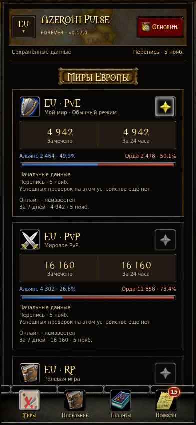
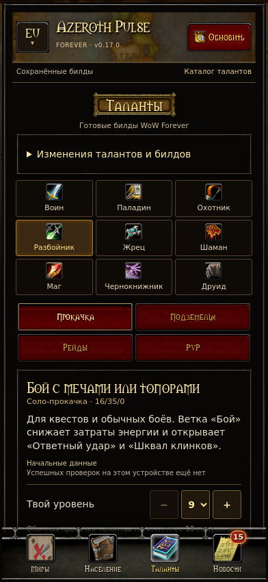
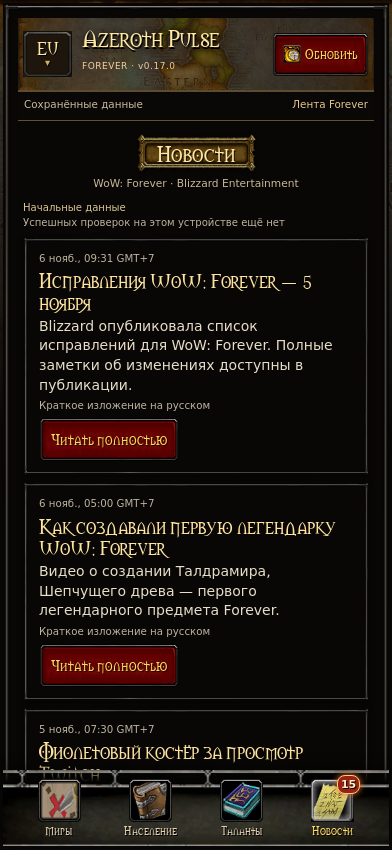

# Azeroth Pulse

Android-компаньон для WoW Forever с интерфейсом в стиле игры.

**Публичная бета 0.17.0 · Android 8 и новее · Русский интерфейс**

[Скачать APK](https://github.com/ololoshka2018/Azeroth-Pulse/releases/latest) · [Сообщить об ошибке](https://github.com/ololoshka2018/Azeroth-Pulse/issues) · [Обработка данных](PRIVACY.md) · [Сторонние материалы](THIRD_PARTY.md)

## Возможности

| Вкладка | Содержание |
| --- | --- |
| Миры | Режимы EU и US, охват переписи и фракции |
| Население | Распределение выборки по расам, классам и фракциям |
| Таланты | 64 стартовых билда для девяти классов, деревья, эффекты рангов и порядок прокачки |
| Новости | Лента Blizzard, чтение внутри приложения, русский перевод и оригинал |

На иконках новостей и талантов появляются отметки новых записей. Внутри вкладки талантов находится журнал новых билдов, изменений очков, порядка прокачки и описаний.

Каждый блок показывает своё время успешной проверки. Дата среза указана отдельно. При сбое доступны сохранённые данные. Показатели переписи относятся к замеченным персонажам в выборке. Поле текущего онлайна имеет значение «неизвестен».

## Интерфейс

Примеры с начальной офлайн-подборкой.

| Миры | Таланты | Новости |
| --- | --- | --- |
|  |  |  |

## Установка и обновления

1. Откройте последний выпуск и скачайте `Azeroth-Pulse-0.17.0.apk`.
2. Подтвердите установку в Android. Play Protect может предложить проверку APK.
3. Выберите EU или US кнопкой региона в шапке.

Номер версии под названием открывает проверку обновлений и описание нового выпуска. APK загружается из GitHub Releases через выбранный браузер.

Для устройств с Android 9 и новее подготовлена цепочка перехода с тестовой подписи на закрытый ключ публичной серии. Для Android 8 сохраняется совместимая прежняя подпись. Проверка цепочки выполнена средствами Android SDK. Реальная установка поверх тестовой серии остаётся частью бета-тестирования.

## Когда обновляются данные

- Миры и население проверяются по кнопке «Обновить».
- Новости проверяются при запуске и примерно раз в 15 минут, пока приложение открыто.
- Таланты всех классов проверяются примерно раз в 30 минут во время работы приложения. Кнопка запускает проверку выбранного класса сразу.
- Новые версии Azeroth Pulse проверяются при запуске, с интервалом шесть часов в работающем процессе и вручную.

Перевод выполняется Google Translate через ML Kit. При первом использовании загружается языковая модель. [Условия и атрибуция](THIRD_PARTY.md).

## Сборка

Требуются JDK 17, Android SDK 35 и Build Tools 35.0.0. Gradle Wrapper закреплён на версии 8.9 с проверкой контрольной суммы дистрибутива. Android Gradle Plugin закреплён на версии 8.7.3.

```sh
export ANDROID_SDK_ROOT=/path/to/android-sdk
bash ./gradlew :app:testDebugUnitTest :app:lintDebug :app:assembleDebug
```

Отладочный APK имеет отдельный идентификатор `ru.ivan.azerothpulse.dev`. Его можно установить рядом с публичной версией.

Сборка подписанного APK владельцем проекта выполняется с закрытой резервной копией подписи.

```sh
export PULSE_SIGNING_DIR=/private/path/to/signing
bash ./build-apk.sh
```

Сценарий проверяет сертификаты для Android 8, Android 9–12L и Android 13+, выравнивание APK и создаёт файл SHA-256. Публичные сертификаты находятся в `certificates/`. Закрытые ключи и пароли хранятся отдельно.

## Проверки и выпуск

GitHub Actions запускает проверки сборок талантов, извлечения переписи, JavaScript, модульные тесты, Android Lint и сборки APK.

```sh
python3 tests/check_talents.py
node tests/extractor.cjs
bash ./gradlew :app:testDebugUnitTest :app:lintDebug
```

Задача `Signed release` запускается владельцем из ветки main после изменения версии и добавления описания в `docs/releases/`. Для неё владелец настраивает секрет `ANDROID_SIGNING_BUNDLE_BASE64` с Base64 закрытого архива подписи. Содержимое архива включает ключи, пароли и цепочку перехода, поэтому доступ к секрету определяет возможность подписывать обновления приложения. [Безопасность](SECURITY.md).

Тег выпуска и имя APK должны совпадать по номеру версии. Для версии 0.17.0 используется тег `v0.17.0` и файл `Azeroth-Pulse-0.17.0.apk`. Встроенная проверка обновлений читает опубликованные обычные релизы с трёхчастным номером. Метка беты отражает стадию приложения, а выпуск использует основной канал обновлений.

## Известные ограничения беты

- Статистика зависит от охвата публичных переписей и времени осмотра персонажей.
- После изменения структуры внешнего сайта его разбор может потребовать обновления приложения.
- Часть новых билдов и изменённых описаний может отображаться на языке источника.
- Загрузка моделей перевода и обновление поверх тестовой серии требуют проверки на реальных устройствах.

## Лицензии

Оригинальный код распространяется по [MIT](LICENSE). Игровая графика, шрифт, названия и сторонние данные имеют отдельные условия. [Перечень материалов и правообладателей](THIRD_PARTY.md).

Azeroth Pulse — независимый фанатский проект. World of Warcraft и Blizzard Entertainment являются товарными знаками Blizzard Entertainment.
