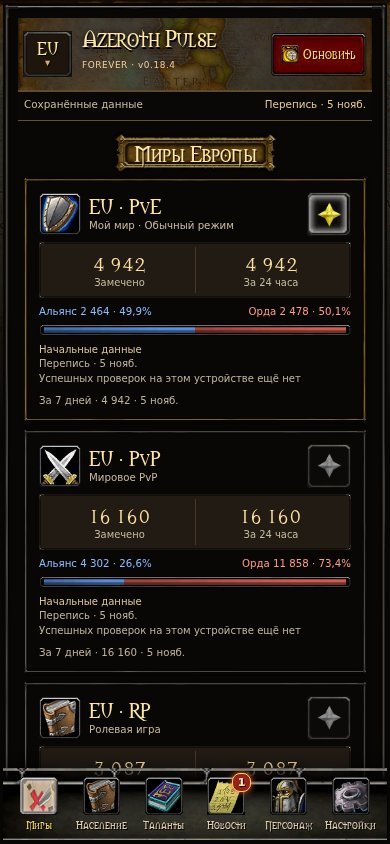
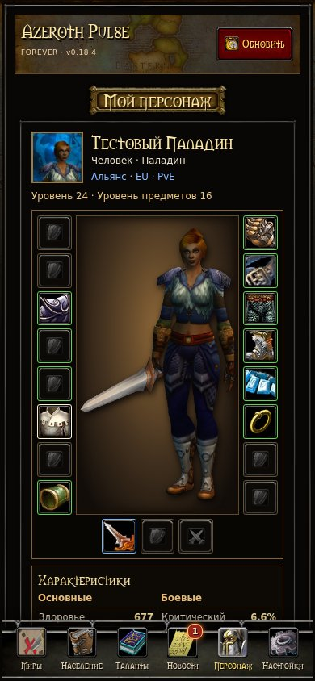
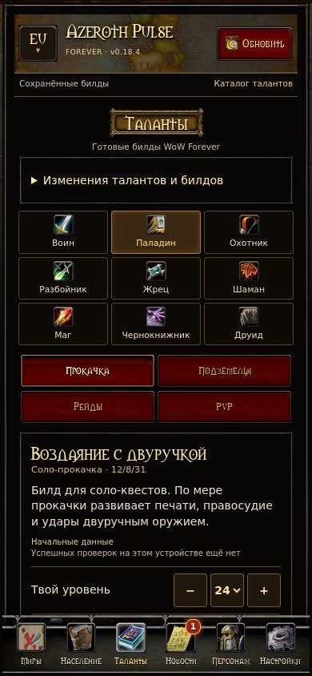
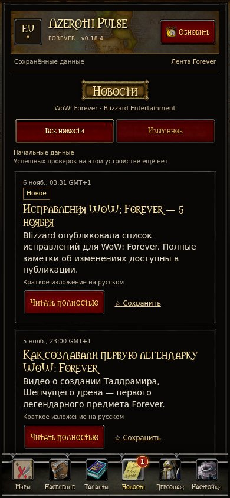

# Azeroth Pulse — WoW Forever

Русскоязычное Android-приложение для World of Warcraft: Forever. Интерфейс в стиле WoW Classic рассчитан на телефон.

**Android 8 и новее** · [Скачать APK](https://github.com/ololoshka2018/Azeroth-Pulse/releases/latest) · [Сообщить об ошибке](https://github.com/ololoshka2018/Azeroth-Pulse/issues)

## Возможности

- **Миры и население.** Режимы EU и US, персонажи, замеченные переписью, и распределение по фракциям, расам и классам.
- **Таланты.** 64 стартовых билда для девяти классов, деревья талантов, порядок прокачки и журнал изменений.
- **Новости.** Лента Blizzard с русским переводом, оригинальным текстом и избранным.
- **Персонаж.** Поиск по имени и фамилии, до десяти сохранённых профилей, HD-снимок, экипировка, характеристики, профессии и таланты. Трансмог указан в слотах с фиолетовой меткой.
- **Настройки.** Размер текста, проверка обновлений приложения и сведения об источниках.

Перепись показывает выборку замеченных персонажей. В профиле отображается снимок данных Blizzard с датой источника.

## Скриншоты

Интерфейс версии 0.18.4 на демонстрационных данных.

| Миры | Персонаж |
| --- | --- |
|  |  |
| **Таланты** | **Новости** |
|  |  |

## Установка и обновления

Скачайте APK из последнего выпуска и подтвердите установку в Android. Для проверки новой версии нажмите номер версии в шапке или откройте **Настройки → Обновления**. Приложение скачивает APK, проверяет его целостность и подпись, затем открывает системный установщик.

## Сборка

Нужны JDK 17, Android SDK 35 и Build Tools 35.0.0.

```sh
bash ./gradlew :app:testDebugUnitTest :app:lintDebug :app:assembleDebug
```

Отладочная сборка имеет идентификатор `ru.ivan.azerothpulse.dev` и устанавливается рядом с публичной версией.

## О проекте

Azeroth Pulse — независимый фанатский проект. Оригинальный код распространяется по [MIT](LICENSE). Игровая графика, шрифт и сторонние данные описаны в [THIRD_PARTY.md](THIRD_PARTY.md). [Обработка данных](PRIVACY.md) · [Безопасность](SECURITY.md)
